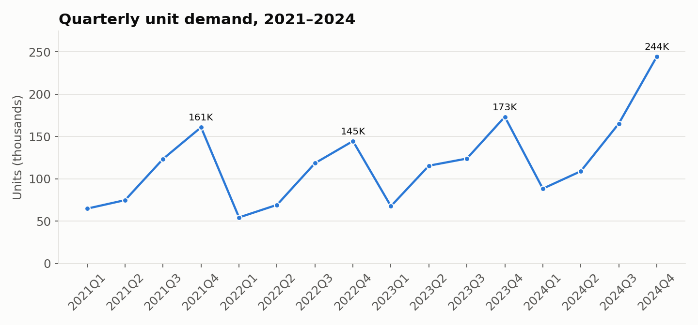

# Product Demand Forecast

A company needs to know how many units it will sell next year so it can plan inventory and staffing. I used four years of quarterly demand to build a one-year forecast in Tableau and put it on a dashboard. I built it as part of a data analytics lab.

**Tools:** Tableau

**Data:** Quarterly unit demand, Q1 2021 to Q4 2024 (16 quarters)

## What I did

- Built a **one-year demand forecast** with Tableau's forecasting tool, which uses exponential smoothing and detects seasonal patterns on its own. The 95% prediction bands are turned on so the forecast shows a likely range.
- Made two versions: one using all the data and one that leaves the last quarter out of the fit, to see how much a single strong quarter changes the forecast.
- Put both views on a dashboard.

## What I found

- **Demand is very seasonal.** Every year it starts low in Q1 and climbs through Q4. Q4 averaged about 181,000 units, compared to about 69,000 in Q1, so the busiest quarter is roughly 2.6 times the slowest one.
- **Demand is growing overall.** Yearly demand went from 424,000 units in 2021 to 607,000 in 2024, up 26% in the last year alone. 2022 was the one down year (387,000).
- **Q4 2024 was a record** at 244,000 units, well above any earlier quarter. Because it's the latest data point, it has a big pull on the forecast, which is why I compared the version with and without it.

## What this means for planning

- Build inventory during Q2 and Q3 so the company is ready for the Q4 peak.
- Plan staffing around the seasonal swing instead of an even level all year.
- Watch Q1 2025 closely. If demand stays well above past Q1 levels, the Q4 2024 jump was real growth and not a one-time spike.

*This preview chart was made from the project data so it shows up on GitHub. The forecast and dashboard are in the Tableau workbook.*

## Files

| File | What it is |
|---|---|
| `Product Demand Forecast.twb` | Tableau workbook with both forecasts and the dashboard |
| `Lab_10_5_Data.xlsx` | Quarterly demand data the workbook reads |

**To open the workbook:** open the `.twb` in Tableau Desktop or Tableau Public. If Tableau asks where the data is, point it to `Lab_10_5_Data.xlsx` in the same folder.
